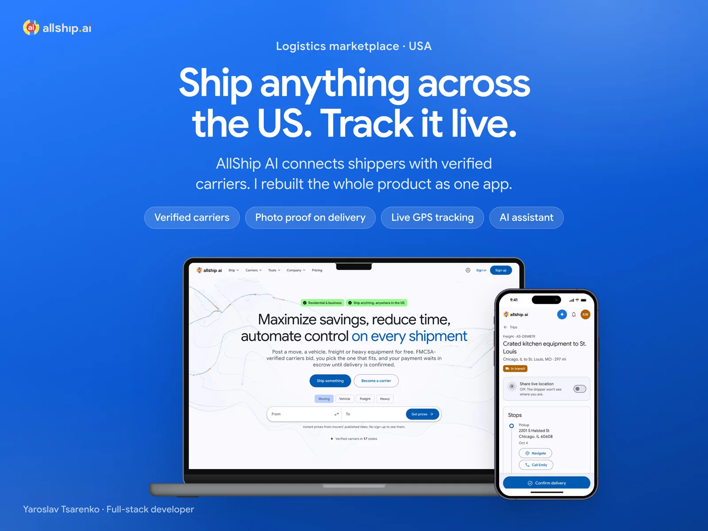
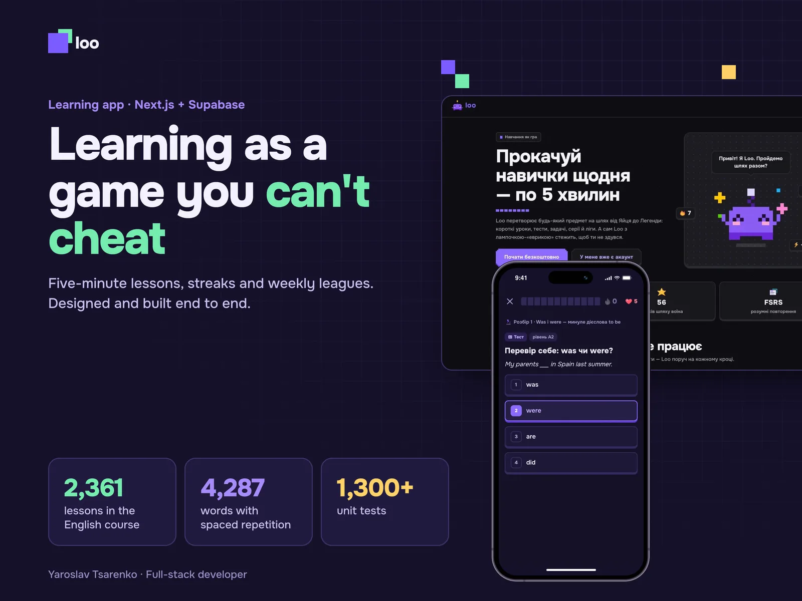
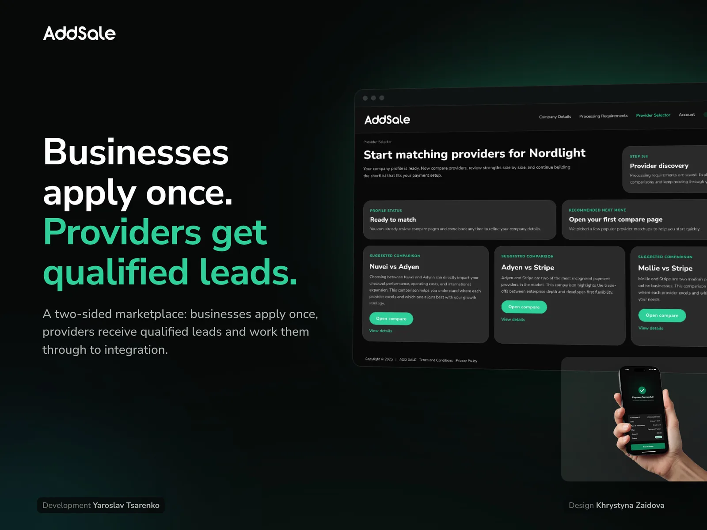
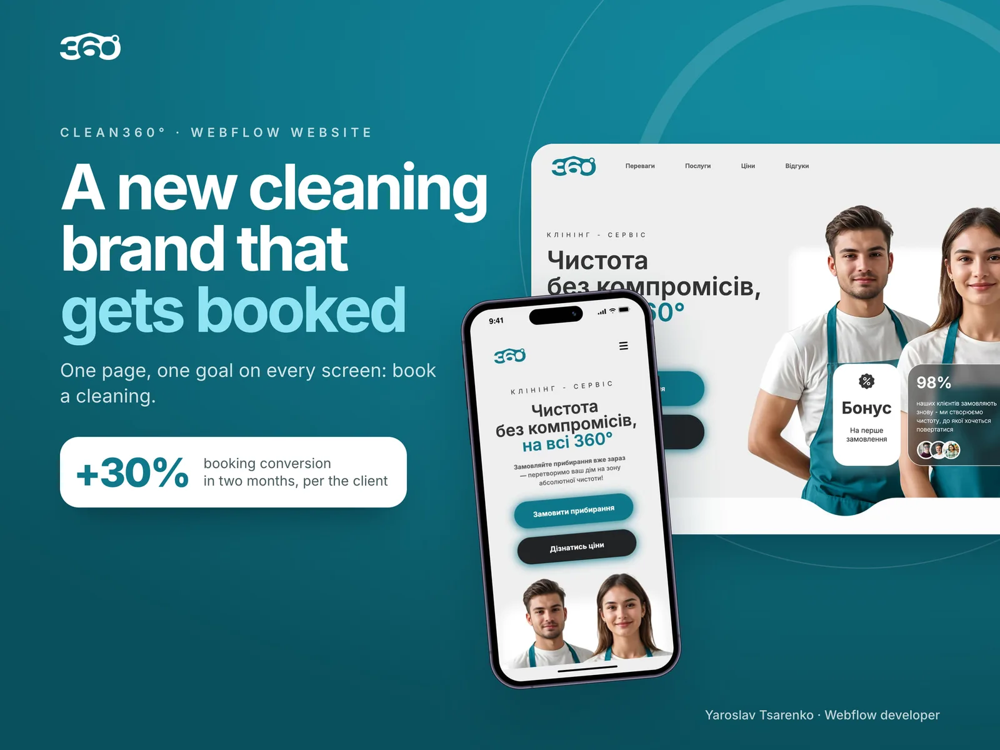
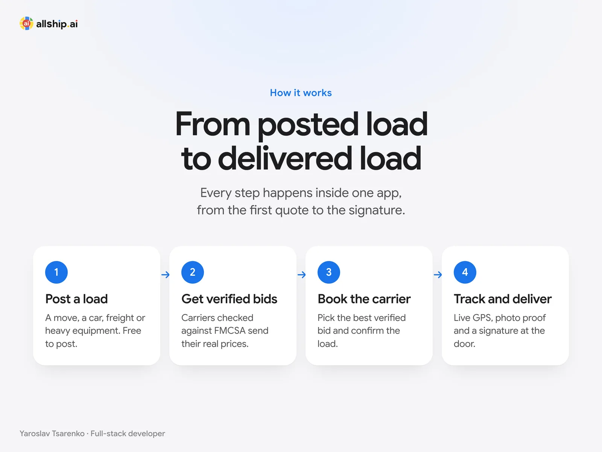
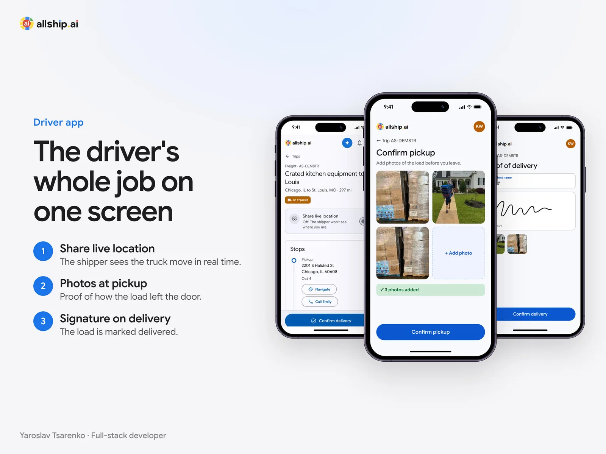
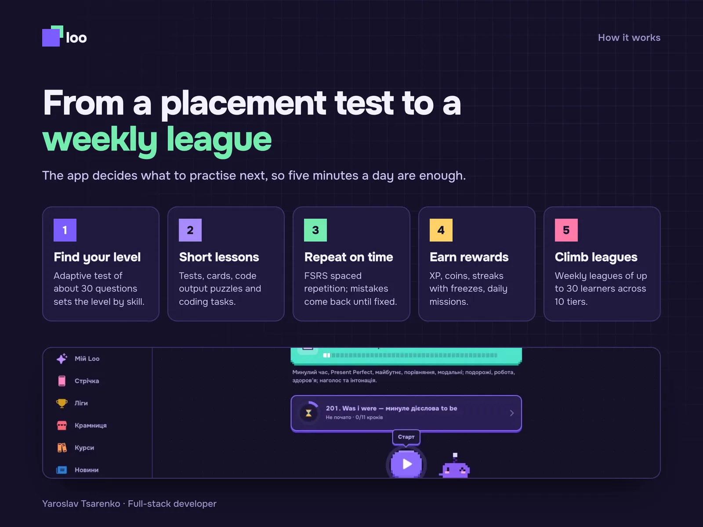
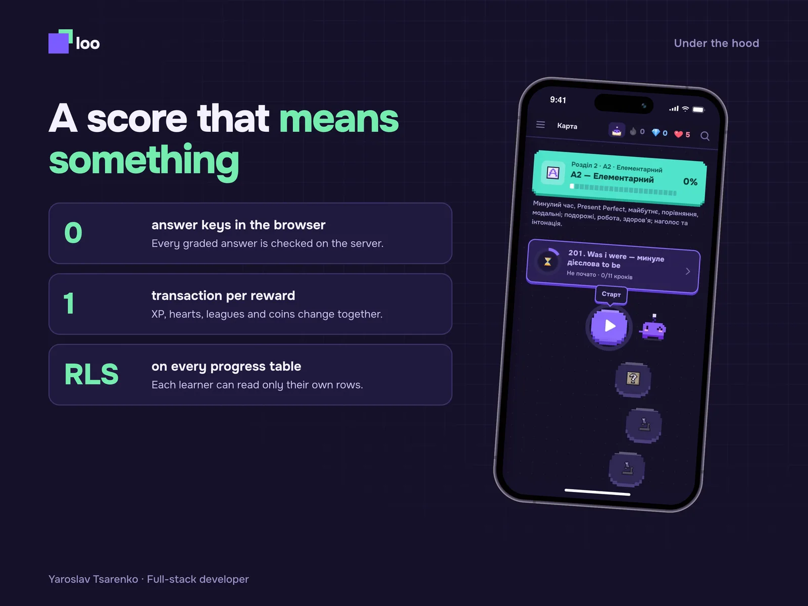
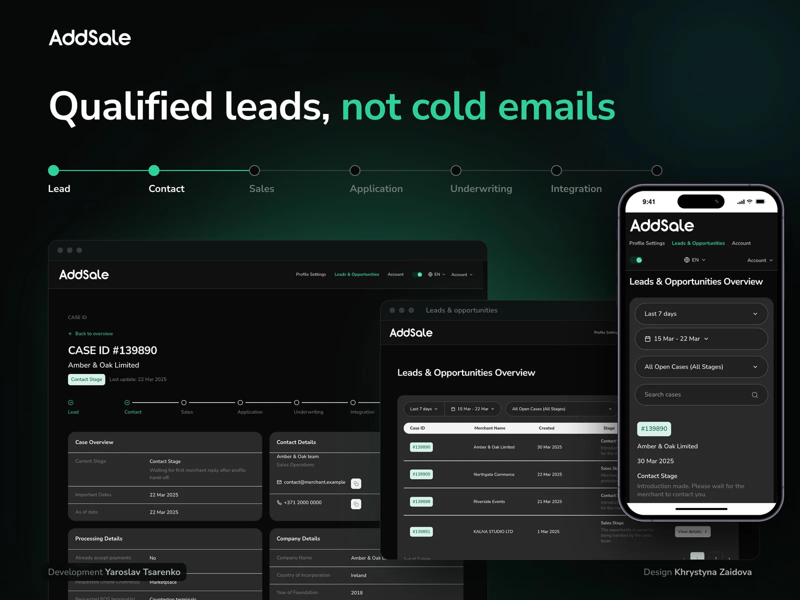
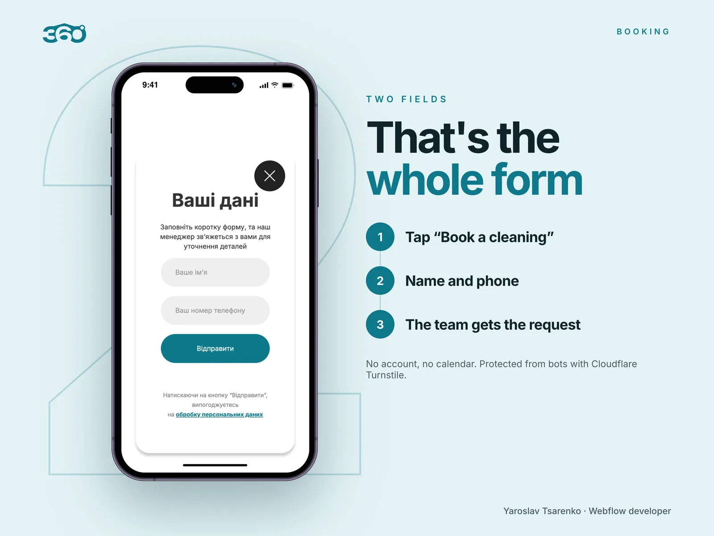

## Yaroslav Tsarenko

Full-stack engineer from Kyiv. I take products from the database to the screen in **Next.js, React, TypeScript, Node.js and PostgreSQL**: SaaS MVPs, marketplaces with several roles, admin panels, background jobs and AI features that work on real data.

Commercial work since 2021, BSc in Computer Science (2026). I also fix and finish apps that started in Lovable, Bolt, Cursor or v0: security, data, sign-in, speed, tests.

[yaroslavtsarenko.com](https://yaroslavtsarenko.com) · [yaroslavtsarenkodev@gmail.com](mailto:yaroslavtsarenkodev@gmail.com) · UTC+2/+3, overlapping EU hours and US mornings

 

---

### Case studies

<table>
<tr>
<td width="50%" valign="top">

<b>AllShip AI</b> · US logistics marketplace, 2026 
Three apps rebuilt into one. 109 entry points audited, every real user migrated.
</td>
<td width="50%" valign="top">

<b>Loo</b> · own learning app, 2026 
Server-checked lessons, spaced repetition, weekly leagues. 1,300+ unit tests.
</td>
</tr>
<tr>
<td width="50%" valign="top">

<b>AddSale</b> · B2B marketplace, Latvia, 2025 
Launched in four months by a team of two. Seven-stage lead pipeline, 50 SEO pages.
</td>
<td width="50%" valign="top">

<b>Clean360</b> · Webflow website, 2024 
Prices up front and a two-field booking form. +30% booking conversion, per the client.
</td>
</tr>
</table>

 

### AllShip AI

**A US marketplace for moving, vehicle, freight and heavy-equipment shipping.** Shippers post a load, FMCSA-verified carriers bid, drivers deliver with live tracking and photo proof.

The product lived in three repos, the database was mostly bots and generated bids, and there was no consistent authorization layer. In 2026 I rebuilt it alone as one Next.js app and moved every real user across.

<table>
<tr><td><b>Role</b></td><td>Solo: product, architecture, design system, frontend, backend, security, data migration</td></tr>
<tr><td><b>Stack</b></td><td>Next.js 16 · React 19 · TypeScript · PostgreSQL · Drizzle · Supabase · OpenAI · Vercel</td></tr>
<tr><td><b>Result</b></td><td>3 apps → 1 · 109 entry points audited for authorization · 16 real users and 5 carriers migrated, none lost</td></tr>
</table>

<table>
<tr>
<td width="50%" valign="top"></td>
<td width="50%" valign="top"></td>
</tr>
</table>

- **Audit and migrate.** Read the legacy data, kept 16 real accounts and 5 carriers, left 34,921 bot accounts and fake records behind.
- **One app, four roles.** Clean domain model and dashboards for shippers, carriers, drivers and admins.
- **Live operations.** GPS tracking, photo proof at pickup, signature on delivery, chat and disputes.
- **AI that never acts alone.** A tool-using OpenAI assistant suggests actions as buttons; the user confirms. Strict CSP and row-level security on every table.

[Live app](https://allship-ai.vercel.app) · [Repository and full write-up](https://github.com/yaroslav-tsarenko/allship-ai#readme)

 

### Loo

**My own Duolingo-style app for Ukrainian speakers.** Any subject becomes a path of five-minute lessons with XP, streaks and weekly leagues, and nobody can cheat their way up.

<table>
<tr><td><b>Role</b></td><td>Product and full-stack engineer</td></tr>
<tr><td><b>Stack</b></td><td>Next.js 16 · React 19 · TypeScript · Supabase · PostgreSQL · Drizzle · Vitest · Playwright</td></tr>
<tr><td><b>Result</b></td><td>JavaScript and English courses · 4,287 words with spaced repetition · 1,300+ unit tests · PWA</td></tr>
</table>

<table>
<tr>
<td width="50%" valign="top"></td>
<td width="50%" valign="top"></td>
</tr>
</table>

- **Courses as content.** A compiler turns Markdown and a course manifest into sections, lessons, topic tests and exam pools, so new courses ship without code.
- **The server is the source of truth.** Answer keys never reach the browser in graded steps; XP, hearts, leagues and currencies change in one server transaction under row-level security.
- **Learning that sticks.** FSRS spaced repetition, a mistakes queue and an adaptive CEFR placement test.
- **Run like a product.** Own analytics, an admin for users and the game economy, a blog with static generation.

[playloo.app](https://playloo.app) · [Repository](https://github.com/yaroslav-tsarenko/loo#readme)

 

### AddSale

**A Latvian two-sided B2B marketplace.** Businesses describe themselves once; providers receive qualified leads with the full requirements and work them through a shared pipeline. Built with designer Khrystyna Zaidova.

<table>
<tr><td><b>Role</b></td><td>Full-stack developer</td></tr>
<tr><td><b>Stack</b></td><td>Next.js · React · TypeScript · MongoDB · NextAuth · MUI · Resend · Cloudflare Turnstile</td></tr>
<tr><td><b>Result</b></td><td>Launched in 4 months · 7-stage lead pipeline · 50 SEO pages in English and Latvian</td></tr>
</table>

- **One application.** Turnover, industry, channels and timeline captured once, in a structure every provider can read.
- **Provider profiles.** Nine tabs with searchable lists that feed both matching and public pages.
- **Content and security.** Pages in two languages from day one; email verification, Argon2 and bot protection.

 

### Clean360

**A one-page Webflow site for a brand-new cleaning company** that needed bookings from the first week, with no clients and no reputation yet.

<table>
<tr><td><b>Role</b></td><td>Webflow developer</td></tr>
<tr><td><b>Stack</b></td><td>Webflow · Webflow CMS · Cloudflare Turnstile · Google Analytics</td></tr>
<tr><td><b>Result</b></td><td>+30% booking conversion in the first two months, per the client</td></tr>
</table>

Six core services and 13 add-ons priced on the page, real team photos and reviews, and a booking form with two fields: name and phone.

 

---

### Experience

<table>
<tr><td><b>ArmySOS</b></td><td>2026 – now</td><td>Kotlin Multiplatform, mostly Android; imports of 1,500–10,000 objects without UI freezes</td></tr>
<tr><td><b>DT Studios</b>, Latvia</td><td>2026 – now, part-time</td><td>Next.js, Prisma and PostgreSQL builds, CRM and CMS, webhooks</td></tr>
<tr><td><b>SimplyDepo</b></td><td>2025 – 2026, contract</td><td>Backend: slow PostgreSQL queries tuned with EXPLAIN ANALYZE and indexes, notifications on a Redis / AWS SQS queue with retries, large PDF reports as streaming background jobs</td></tr>
<tr><td><b>Tresor.tech</b></td><td>2024 – 2025</td><td>Full stack: 20+ client interfaces, load time about 30% faster, Node.js and MongoDB booking APIs</td></tr>
<tr><td><b>AllShip.ai</b></td><td>2023 – 2024</td><td>Full stack: OpenAI assistant answering 20+ operator questions from company data, test coverage on core flows to 85%, production crashes down about 20%</td></tr>
<tr><td><b>Stream</b></td><td>2021 – 2023</td><td>Front end</td></tr>
</table>

 

---

### Open-source work

**[Floatline](https://github.com/yaroslav-tsarenko/floatline)**: CS2 skins marketplace on top of an aggregator of 28+ trading platforms. Orders reconcile from webhooks and a polling job without being applied twice; background work runs as cron routes inside Next.js. 
Next.js 16 · Drizzle · Neon Postgres · pg_trgm search

**[Keyarcade](https://github.com/yaroslav-tsarenko/keyarcade)**: digital game-key store on the Kinguin API, with a local catalog fallback when the API is down, accounts and PDF invoices by email. 
Next.js 16 · Neon · pdfkit · nodemailer

**[Datumskins](https://github.com/yaroslav-tsarenko/datumskins)**: CS2 skins store designed as an engineering drawing: every listing is a spec sheet with a wear gauge, grade and trade status. 
Next.js 16 · Prisma 7 · Postgres · next-intl

| Project | What it is | Stack |
|---|---|---|
| [Kirosim](https://github.com/yaroslav-tsarenko/kirosim) | Travel eSIM store with a token-based design system; same commerce core as [Velusim](https://github.com/yaroslav-tsarenko/velusim) | Next.js 16 · Neon |
| [E-commerce platform](https://github.com/yaroslav-tsarenko/e-commerce-store-beta) | Storefront and admin: CSV/Excel import, Google and Facebook product feeds, CMS, analytics | Next.js 16 · Prisma · next-intl |
| [Cartridge Club](https://github.com/yaroslav-tsarenko/cartridge-club) | Game-key store UI on a strict design-token system, WCAG AA | Next.js 15 · Tailwind v4 |
| [AIFitWorld](https://github.com/yaroslav-tsarenko/aifitworld-own) | Personalised workout programs generated with GPT-4 and DALL·E 3 | Next.js · OpenAI |

 

---

### Toolbox

<table>
<tr><td><b>Frontend</b></td><td>React, Next.js (App Router, Server Components, Server Actions), TypeScript, Tailwind, MUI, Radix, GSAP, WebGL</td></tr>
<tr><td><b>Backend</b></td><td>Node.js, Express, PostgreSQL, Supabase, Drizzle, Prisma, Redis, MongoDB, queues and background jobs</td></tr>
<tr><td><b>AI</b></td><td>OpenAI API (tool calling, streaming, Responses API), assistants scoped to the user's own data</td></tr>
<tr><td><b>Quality and ops</b></td><td>Vitest, Jest, Playwright, GitHub Actions, Docker, AWS, Vercel, Sentry</td></tr>
<tr><td><b>Also</b></td><td>Python (Flask, small services), Kotlin Multiplatform, Webflow</td></tr>
</table>
